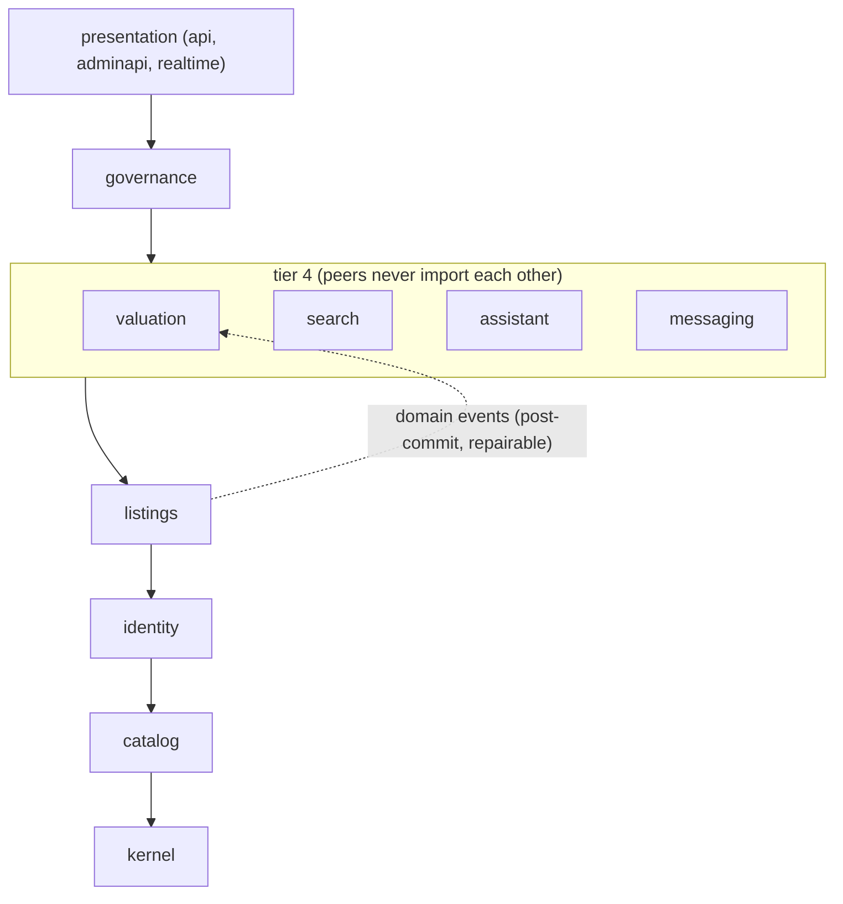
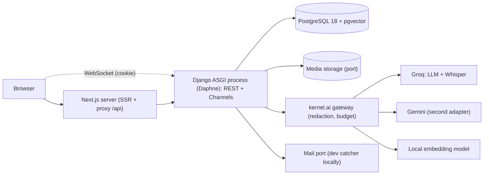
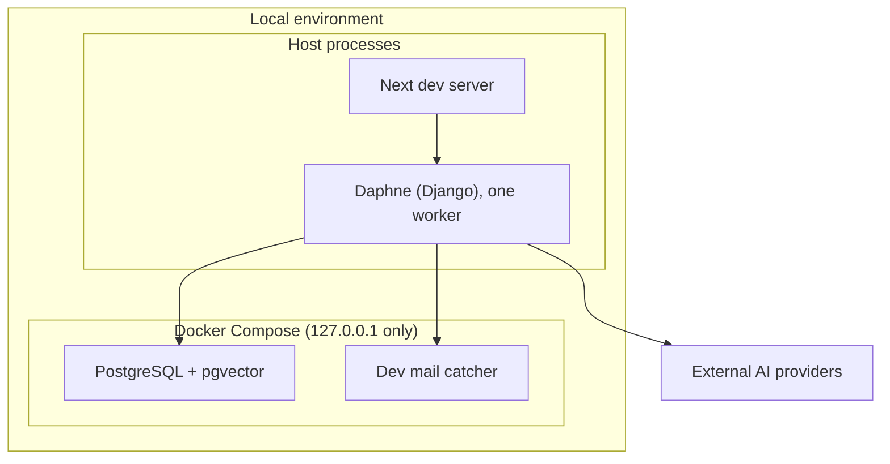

# Architecture Spine: EstateAI

## Design Paradigm

**Modular monolith with a service layer.** One Django project, one app per PRD domain. A domain app holds models, services (writes), selectors (reads) and events; all HTTP and WebSocket code lives in a top presentation layer. Dependencies point downward only. External providers sit behind ports in the kernel. Services enforce policy themselves (AD-22); presentation permission classes are only a first gate.

| Layer (bottom to top) | Package under `apps/` | Owns |
| --- | --- | --- |
| 0 | `kernel` | errors, ids, idempotency, audit writer, notification writer, domain-event bus, feature flags, rate limits and AI budget, runtime executors, AI gateway, storage and mail ports, shared privacy patterns, structured logging |
| 1 | `catalog` | Field registry, filter schema (`ListingFilter`), cities and localities, amenity and facility catalogue, knowledge base (RAG) |
| 2 | `identity` | accounts, account state, individual and agency profiles, email verification, capability matrix, account lock |
| 3 | `listings` | Listing aggregate, location, private address, details, terms, media, revisions, lifecycle, visibility policy, favourites, quota policy, publication |
| 4 | `valuation`, `search`, `assistant`, `messaging` | estimates and forecast; natural-language interpretation; AI Listing Assistant; Conversations and Messages |
| 5 | `governance` | Reports, moderation, Verification, support and deactivation requests, audit review, cross-app account use cases |
| 6 presentation | `presentation/api`, `presentation/adminapi`, `presentation/realtime` | DRF views, serializers, routers, Channels consumers |

## Invariants & Rules



### AD-1 — Paradigm and app map [ADOPTED]

- **Binds:** all backend code
- **Prevents:** visibility, quota and redaction rules re-implemented per feature; apps reaching into each other
- **Rule:** one Django app per domain in the table above. A domain app's public surface is `services`, `selectors`, `events` and (for `catalog`) `filters`; nothing outside an app imports its `models` or internals. No HTTP, DRF or Channels code inside a domain app. The package is named `kernel`, never `platform`.

### AD-2 — Dependency direction

- **Binds:** all backend code; FR-21, NFR-7
- **Prevents:** cycles such as listings to valuation; peers coupling; a foreign key pointing upward
- **Rule:** an app imports only public modules of lower layers. Tier-4 peers never import each other; they cooperate through lower layers or events. Composite resources (for example listing detail with estimate, agency info and favourite flag) are assembled in `presentation`. An import-linter `layers` contract (containers, exhaustive) encodes the order and fails CI on violation.

### AD-3 — Data ownership and access [ADOPTED]

- **Binds:** all tables
- **Prevents:** two writers per table; cross-app joins that bypass rules
- **Rule:** only the owning app writes its tables, through its services (see the ownership table in Structural Seed). Other apps read through the owner's `selectors`. Database foreign keys point to the same or a lower layer only; kernel tables hold `account_id` / `actor_id` as plain UUID columns with no foreign key. Serializers are explicit allowlists; `fields = "__all__"` is forbidden.

### AD-4 — One canonical Listing and one Field registry

- **Binds:** FR-11..FR-17, FR-22, FR-25, FR-34, FR-35, FR-42, FR-67
- **Prevents:** a second property representation; field lists hand-copied into forms, AI schemas, filters and OpenAPI; private fields becoming searchable
- **Rule:** `PropertyListing` plus `PropertyLocation`, `PrivatePropertyAddress`, `ResidentialDetail` / `PlotDetail` / `CommercialDetail`, `ListingTerms`, `PropertyMedia`, `ListingAmenity` and `ListingRevision` is the only property model. The Field registry (YAML in `catalog`, versioned, loaded at start-up, served at `GET /api/v1/registry`) defines per field: id, type, requirement level, applicability, allowed values, class (public or private), and flags `searchable`, `sortable`, `ai_extractable`, `valuation_input`, `quota_identity`. The loader rejects a private-class field flagged searchable, sortable or valuation_input. Validation, serializers, AI extraction schemas, the filter schema and static OpenAPI enums are generated from it. `registry_version` is stored on Listings and Assistant sessions. Sale and rent terms live in `ListingTerms` (typed nullable columns for active fields, registry-validated JSONB `extra_attributes` for deferred fields only). Cities, localities, amenities and facilities are database-managed reference data, served at `/api/v1/reference/*`, validated against their tables and never emitted as OpenAPI enums. A Locality has a `kind` (area or society); phase, sector and block are text on `PropertyLocation`. [ASSUMPTION]

### AD-5 — Single visibility policy

- **Binds:** FR-33, FR-40, FR-48, FR-53, FR-74, FR-75; B18
- **Prevents:** the public-visibility predicate duplicated in discovery, detail, media, favourites, counts and chat
- **Rule:** `listings.selectors.public_listings()` and `listings.policy.can_view(viewer, listing)` are the only implementations; the viewer is an `Actor` (Visitor included). Public iff status = published AND not restricted AND `identity.selectors.is_active_owner(owner)`; every other case returns not-found. Discovery, detail, media, favourites, Conversation headers, realtime events, counts, aggregates and facets start from `public_listings()`. Public responses are built from separate public projection types, never from model instances. "Under review" is derived from open Reports.

### AD-6 — Account state, capabilities and private reads

- **Binds:** FR-3, FR-4, FR-8, FR-9, FR-59, FR-61, FR-74; B19, B21
- **Prevents:** scattered suspension checks; email-verification bypass on reactivation; administrator reads that skip the audit
- **Rule:** `identity` owns account state as separate conditions (email verified, suspended, deactivated) and exposes `can(actor, capability)` (FR-74 matrix) and `lock_account(account_id)`. There is one Administrator role. A private read (phone, Private address, Drafts, Assistant history, Verification evidence, support content, Report-linked Messages) goes through an owning-app `admin_read_*` selector that first calls `kernel.privacy.record_private_read(actor, reason, target_ref)` and fails closed if the audit write fails. Targets are a closed enum; the request is POST-only with a per-read reason in the body; a test enumerates every private target. The Report-message window (reported plus 5 preceding) is a `messaging.selectors` function. The audit table is append-only for the runtime database role. Django admin is disabled outside local.

### AD-7 — Publication and quota transaction

- **Binds:** FR-17, FR-18, FR-20, FR-60, FR-72, SYS-017; B17, B24
- **Prevents:** over-quota publication, double charging, quota bypass, a second path to published
- **Rule:** only `listings.publication` (`publish`, `republish`, `restore_after_moderation`) sets status to published; `set_status` rejects it. One transaction: `identity.lock_account`, then lock the listing (order: account then listing; edits lock only the listing), compare `base_revision`, validate, claim the idempotency key, check quota, write `PublicationEvent` (kind: initial, republish_counted, republish_free, restore, seed), set status, write the audit record. The identity-field fingerprint is SHA-256 over the canonical values of registry fields flagged `quota_identity`; republication compares against the last counted event; the 24-hour one-time correction (B24) is a flag on that event. A registry change adding an identity field ships a data migration recomputing fingerprints without consuming quota. The seed command publishes through `publish` with a system actor and the `seed` event kind. LLM calls, uploads, email and estimates stay outside the transaction.

### AD-8 — AI gateway and redaction [ADOPTED]

- **Binds:** FR-25..FR-32, FR-35, FR-37, FR-38; B20, NFR-3
- **Prevents:** a provider call that skips redaction, throttling or logging; provider lock-in; schema or quota surprises
- **Rule:** `kernel.ai` exposes ports (LLM, embeddings, speech-to-text) that accept only `RedactedText`; the single constructor `redact(text, known_values)` runs exact-value scrubbing of the actor's known phone, email and Private address first, then the shared patterns (AD-9). Only `kernel.ai` may import a provider SDK or open outbound network (allowlisted hosts; CI import check bans `httpx`, `requests` and LangChain callbacks elsewhere). Every call also applies input caps, timeouts (12 s search, 20 s assistant turn), the budget (AD-25), the feature flag and the request log (provider and model, no content); provider and validation error bodies are never logged or returned. Assistant history stores redacted text only. Adapters: Groq first (LLM and Whisper), Gemini second; the embedding model runs locally; LangChain only inside an adapter. Registry-generated structured-output schemas must satisfy strict mode (every property required, `additionalProperties:false`, no reliance on min/max constraints) and stay well under the provider's per-request token cap, with one retry on a 400. Unpaid Gemini inputs may be used by the provider, so redaction is the only control and SM-6 canary tests cover every adapter and entry point. Tests default to the recorded-stub adapter.

### AD-9 — Shared privacy patterns

- **Binds:** FR-23, FR-32, FR-13, SM-6
- **Prevents:** Listing text checks and AI redaction using different phone and address definitions
- **Rule:** `kernel.privacy.patterns` is the only definition of phone, email and address patterns, with a false-positive test set (prices, areas, counts). Listing text validation and `redact()` both use it; no other contact-data regex exists.

### AD-10 — AI proposes, services dispose

- **Binds:** FR-24..FR-30, FR-22, SYS-020..022
- **Prevents:** model output writing data, forging confirmation, or bypassing validation
- **Rule:** the Assistant returns candidate field updates (schema from the registry) and applies them only through `listings.services.apply_updates(actor, listing_id, base_revision, updates)`, which validates against the registry and rejects a stale revision (409). `origin` and `confirmed` are set by the service from the actor and call path, never from model output or client payload. Publication refuses unconfirmed sensitive fields. The Assistant never imports Listing models.

### AD-11 — One filter schema for conventional and natural-language search

- **Binds:** FR-34..FR-38, SM-3
- **Prevents:** two search paths with different semantics; model-generated SQL; filters executed in the wrong layer
- **Rule:** `ListingFilter` and its registry-driven translator live in `catalog.filters`. `listings.selectors.search_public(actor, spec, sort, cursor, limit)` is the only function turning a spec into a query and always starts from `public_listings()`. `search` owns NL interpretation, required-versus-preference rules and the interpretation preview; its output is a `ListingFilter`. The NL query is sent in a POST body, never a URL. No model text reaches SQL. Null never matches a required criterion. Embeddings serve only the RAG knowledge base (pgvector).

### AD-12 — Valuation

- **Binds:** FR-42..FR-47, FR-77; B22, B13
- **Prevents:** private data in model inputs; stale or non-reproducible estimates; unsafe model loading
- **Rule:** inference runs in-process in `valuation` on the AD-14 executor (target p95 under 1 s). Features come only from registry fields flagged `valuation_input`. A stored estimate records the model-input snapshot hash, model version and feature-schema version. `valuation.selectors.current_estimate` recomputes lazily when the snapshot is stale or absent, so a lost event self-heals; Visitors read stored results and never trigger computation; a Publication never waits on an estimate. `listings.services` emits `listing.model_inputs_changed` when a `valuation_input` field changes. Model artifacts are built by the repo's training script and loaded only after a hash check. The synthetic generator, training script and forecast parameters live in `valuation/data`.

### AD-13 — Realtime messaging [ADOPTED]

- **Binds:** FR-48..FR-53; SM-7
- **Prevents:** a client choosing rooms; events for non-participants; delivery reported before saving; cross-site WebSocket hijack
- **Rule:** Messages are sent by REST (the `Idempotency-Key` is the message's `client_message_id`); the WebSocket is receive-only. The consumer authenticates the session, checks the Origin against the exact configured origins (scheme, host and port; not the stock host validator), joins only the group of its authenticated account, and is closed when that session ends, on password change, deactivation or anonymisation. Each Conversation has a monotonic `seq`; clients resume with a REST history request carrying `after=<seq>`. Frame size, idle time and connections per account are capped. `messaging.services` derives recipients from the Conversation row and publishes via on-commit dispatch (AD-18). Writability and header content follow AD-5 and FR-48. In deployment `/ws` is routed on the same host as the site.

### AD-14 — Runtime and concurrency [ADOPTED]

- **Binds:** NFR-1, SM-7; A7
- **Prevents:** slow AI or image work starving chat and sign-in; hidden dependence on Redis or a queue
- **Rule:** Daphne runs one process with one worker; the in-memory channel layer is used only in this shape and any second worker is forbidden. Under ASGI synchronous views share one thread [ASSUMPTION refuted by the Story 1.2 spike, see `docs/architecture-notes.md`; amend before the messaging epic], so message send, sign-in and session endpoints are async or DB-only, and no endpoint holds that thread for more than 200 ms of non-database work. AI calls, image re-encode and model inference run on a bounded executor owned by `kernel.runtime` (or async HTTP). Periodic work (cleanup, retention, anonymisation) is management commands, not a queue. Redis only if the SM-7 latency test under AI load fails.

### AD-15 — Media [ADOPTED, revised]

- **Binds:** FR-15, FR-6, FR-7, FR-57, FR-21, SM-6
- **Prevents:** a file fetchable after its visibility ends; image metadata leaking location; hostile uploads
- **Rule:** all media is served by one Django endpoint that applies AD-5 and AD-22 at request time; there is no stored public or private class. Public images carry short cache headers; a deployment proxy may offload serving only by verifying the same rule. Files sit behind a storage port with random keys. Uploads pass through Django: pre-decode size cap, pixel and decompression-bomb limits, type allowlist, re-encode, metadata strip, per-account storage cap checked atomically. Verification evidence may also be a PDF (allowlisted, size-capped) served with `Content-Disposition: attachment` and `nosniff`.

### AD-16 — API contract

- **Binds:** all endpoints; A5, NFR-7
- **Prevents:** frontend and backend drift; inconsistent errors, pagination and retries
- **Rule:** the backend generates OpenAPI (drf-spectacular) under `/api/v1/` and commits `openapi.yaml`; CI fails if it is stale. Errors use `{error:{code,message,fields,request_id}}` with a code catalogue in the schema (409 stale revision, 422 `idempotency_key_reused`, 429 throttled). Pagination is cursor-based. One idempotency mechanism: `kernel.idempotency.claim(scope, account_id, key, request_hash)` is called inside the service transaction, keyed per account, 24 h TTL; the same key with a different request hash is rejected. WebSocket event shapes are committed as JSON Schema beside the OpenAPI file.

### AD-17 — Auth, session and transport

- **Binds:** FR-3..FR-5, FR-9, FR-10; R1
- **Prevents:** tokens in browser storage; CSRF and host-header gaps; spoofed client addresses
- **Rule:** Django sessions in an HttpOnly, Secure, SameSite=Lax cookie with CSRF; a new session at sign-in; sessions end on sign-out, password change and deactivation. Next.js proxies `/api/*` to Django (same origin); the WebSocket connects directly. Django trusts forwarded client addresses only from configured trusted proxies. Absolute links in emails come from `FRONTEND_BASE_URL`, never the Host header. Security headers and a CSP are set; `ALLOWED_HOSTS` and trusted origins are explicit. Administrator sign-in uses its own endpoint; every `/api/v1/admin/*` route requires the Administrator capability, with shorter sessions.

### AD-18 — Side effects and events

- **Binds:** FR-17, FR-48, FR-63, FR-69, FR-76
- **Prevents:** emails or events for rolled-back work; lost repairs; audit gaps
- **Rule:** audit records are written in the same transaction as the action. Domain events, notifications, emails and WebSocket pushes dispatch with `transaction.on_commit(robust=True)`, one callback per subscriber; a handler failure is logged and never changes the response. Events are only for derived, repairable consequences (estimate, notification, socket close); consequences that must not be lost use AD-23. Event definitions live in the emitting app's `events` module; subscribers register in `AppConfig.ready`; emitters never import subscribers. No external call occurs inside a transaction.

### AD-19 — Frontend structure [ADOPTED]

- **Binds:** frontend repo; NFR-6, NFR-9
- **Prevents:** business rules re-implemented in Next.js; hand-written API types
- **Rule:** Next.js App Router. Public pages are server components fetching from Django with the cookie forwarded; chat, assistant, voice and forms are client components; admin lives in its own route group. All data goes through one client generated from the committed `openapi.yaml` by a single sync script; the generated directory is committed and never hand-edited. No backend-for-frontend aggregation and no visibility, privacy or quota logic in Next.js.

### AD-20 — Environments, configuration and supply chain

- **Binds:** all; A6, FR-73, NFR-2
- **Prevents:** secrets in the repo; behaviour differing silently between environments; tampered dependencies or model files
- **Rule:** settings split into base, local, test and prod, driven by environment variables; prod fails to start on a missing or default secret; a secret scan runs in CI. Local operation: Docker Compose (PostgreSQL with pgvector, dev mail catcher), published on 127.0.0.1 only, plus host processes (Daphne, Next dev). Separate database roles for migrations and runtime. Dependencies are locked with hashes and audited; the embedding model files are pinned and vendored (no runtime download). AI feature flags live in `kernel` and are read by the gateway.
- **Hosted database (A12, confirmed 2026-11-19):** Docker PostgreSQL + pgvector for local and CI; Supabase PostgreSQL as the hosted database, as plain PostgreSQL only. Django migrations are the sole schema authority; the migrator and runtime roles are created by SQL on Supabase; migrations use the direct connection. Local and CI match Supabase's PostgreSQL major version if it differs from 18.

### AD-21 — Test gates

- **Binds:** NFR-7, SM-1..SM-7
- **Prevents:** rules passing review but failing at the boundary
- **Rule:** CI runs the import-linter contract; an AST check banning provider and network libraries outside `kernel.ai`; the OpenAPI drift check and a schema walk asserting no private-class field in any public response; an authorisation matrix generated from the route list (every route declares its permission); the table-driven FR-74 and FR-75 matrix; a Publication concurrency test (SM-5); canary egress tests per adapter and entry point (SM-6); a log scan; on-commit tests with handler-failure injection; fault-injection tests (AI off, mid-publish interruption); and a chat-latency test run while five AI or image requests are in flight (SM-7). Provider-dependent metrics (SM-2, SM-3, SM-11) are measured against live providers outside CI.

### AD-22 — Actor and authorisation in services

- **Binds:** FR-21, FR-74, FR-75; NFR-2
- **Prevents:** one app calling another's service as a suspended or non-owner user; permission logic only in views; existence leaks
- **Rule:** every public mutating service and every non-public selector takes `actor: Actor` (kind user, admin or system; account id; request id) as its first argument and enforces `identity.can` and `listings.policy` itself; services never read ambient request state. Presentation permission classes are a first gate only; DRF defaults to deny and every route declares its permission explicitly. Unauthorised access to a resource returns not-found; sign-in-required endpoints return unauthenticated to Visitors.

### AD-23 — Cross-app consequences, erasure and retention

- **Binds:** FR-8, FR-59, FR-61, FR-69; PRD §8.3
- **Prevents:** half-applied deactivation or suspension; two developers choosing events versus orchestration; retention that never runs
- **Rule:** a state change whose consequences span apps (deactivation, anonymisation, approved deletion, suspension) is one named use case in `governance`, run in one transaction that calls each owner's service in layer order, each owner writing its audit record. Anonymisation uses an `AccountDataEraser` protocol that each domain app implements, run by one `governance` command. Retention is one `run_retention` management command implementing PRD §8.3 (schedule decided at deployment).

### AD-24 — Wire shape

- **Binds:** FR-11, FR-12, FR-22, FR-25; AD-16
- **Prevents:** forms, AI updates, filters and API payloads using different field names or nesting
- **Rule:** a Listing resource is `{id, status, visibility, revision, registry_version, fields:{<registry_id>:value}, media, amenities, ...}`; fields are keyed by registry id, flat, regardless of which table stores them. A mutation is `{base_revision, fields:{...}}`. Unknown is `null`; money is a string; areas carry a unit field. The same registry ids appear in the AI extraction schema, `apply_updates`, `ListingFilter` and the frontend forms.

### AD-25 — Abuse limits and AI budget

- **Binds:** NFR-10, FR-3, FR-32, FR-38, FR-42
- **Prevents:** limits scattered per view, spoofed client identity, free-tier quotas exhausted by one client or by anonymous traffic
- **Rule:** `kernel.ratelimit` holds one policy table covering every NFR-10 limit (scope, window, limit), with counters persisted in PostgreSQL (no Redis). The client key is the account or, for Visitors, the trusted-proxy client address plus session; limits tolerate shared addresses. The AI budget is a persisted ledger per provider and day with a reserved partition for signed-in Listing creation (at least half), configurable to the real provider limits; when exhausted the gateway returns the fallback outcome of FR-38.

### AD-26 — Private-data containment

- **Binds:** NFR-3, FR-13, FR-23, FR-52; SM-6
- **Prevents:** private values leaking through search matches, projections, logs or error bodies
- **Rule:** phone, email and Private address exist only in private-class fields and are never in public projection types, search, sort, ML inputs, AI payloads, URLs, logs or error bodies. Logs use an allowlist of fields; validation and exception bodies are scrubbed; idempotency stores a result reference, not a response body. The schema walk and log scan of AD-21 enforce this.

## Consistency Conventions

| Concern | Convention |
| --- | --- |
| Naming | Python and JSON keys `snake_case`; app names singular domain nouns; registry field ids stable `snake_case`; enums lowercase `snake_case`; event names `domain.past_tense` (for example `listing.published`); URLs plural nouns under `/api/v1/` |
| Data and formats | UUID primary keys; UTC timestamptz serialised ISO 8601; money `NUMERIC` serialised as string, currency PKR; areas carry an explicit unit; unknown is `null`, never zero or false |
| Errors and envelopes | One error envelope and code catalogue (AD-16); cursor pagination; `Idempotency-Key` header |
| State and mutation | Only the owning app writes (AD-3); services take `actor` first (AD-22); Listing changes carry `base_revision`; audit in-transaction, side effects on commit (AD-18) |
| Auth and logging | Capability checks through `identity.can` only; structured JSON logs with `request_id`; logs never contain phone, email, address, message text or search text |
| Observability | AI request log (provider, model, latency, outcome; no content) in `kernel`, read by admin AI oversight (FR-68); structured logs for everything else |
| Configuration | Environment variables only; one settings module per environment |
| Terminology | User-facing and API labels use "AI Price Estimate", "Estimated Property Value" and "5-Year Price Forecast"; the word "demo" appears in none |

## Stack

| Name | Version |
| --- | --- |
| Python | 3.12 (Django 5.2 supports 3.10–3.14; local 3.12.3) |
| Django | 5.2 LTS (5.2.x; supported to at least April 2028) |
| Django REST Framework | 3.18.x (lists Django 5.2, 6.0, 6.1) |
| drf-spectacular | 0.30.x (lists Django 5.2 and 6.0) |
| Django Channels, Daphne | channels 4.3.x (4.3.2 confirmed for Django 5.2/6.0), Daphne as ASGI server |
| PostgreSQL | 18.x (18.7 current) |
| pgvector | 0.8.x via image `pgvector/pgvector:0.8.7-pg18-trixie` |
| psycopg | 3.3.x (Django 5.2 needs 3.1.8 or later) |
| import-linter | 2.x (2.17; needs Python 3.11 or later) |
| Local embedding runtime and model | fastembed 0.9.x with a multilingual model chosen at P5 (candidates 384, 768 or 1024 dimensions); dimension fixed at migration |
| Pillow, pydantic v2, scikit-learn, pandas, XGBoost | per proposal; resolved by hash-locked lockfile |
| Node.js | 24.x LTS (24.22.x, supported to April 2028) or 26.x; pinned in `.nvmrc` |
| Next.js | 16.x (16.4.x; needs Node 20.9 or later), with React and Tailwind CSS (current majors at scaffold) |
| Docker Compose | local PostgreSQL and dev mail catcher |

## Structural Seed

```mermaid
erDiagram
    ACCOUNT ||--o| INDIVIDUAL_PROFILE : has
    ACCOUNT ||--o| AGENCY_PROFILE : has
    CITY ||--o{ AGENCY_PROFILE : "based in"
    ACCOUNT ||--o{ PROPERTY_LISTING : owns
    PROPERTY_LISTING ||--o| PROPERTY_LOCATION : has
    PROPERTY_LISTING ||--o| PRIVATE_PROPERTY_ADDRESS : has
    PROPERTY_LISTING ||--o| LISTING_DETAIL : "category detail"
    PROPERTY_LISTING ||--o| LISTING_TERMS : has
    PROPERTY_LISTING ||--o{ PROPERTY_MEDIA : has
    PROPERTY_LISTING ||--o{ LISTING_AMENITY : has
    AMENITY ||--o{ LISTING_AMENITY : catalogue
    PROPERTY_LISTING ||--o{ LISTING_REVISION : records
    PROPERTY_LISTING ||--o{ PUBLICATION_EVENT : "quota events"
    PROPERTY_LISTING ||--o{ SAVED_LISTING : "saved as"
    PROPERTY_LISTING ||--o{ ASSISTANT_SESSION : "AI sessions"
    ASSISTANT_SESSION ||--o{ ASSISTANT_MESSAGE : contains
    PROPERTY_LISTING ||--o{ VALUATION_RESULT : estimates
    VALUATION_MODEL_VERSION ||--o{ VALUATION_RESULT : produced
    PROPERTY_LISTING ||--o{ CONVERSATION : "discussed in"
    CONVERSATION ||--o{ MESSAGE : contains
    PROPERTY_LISTING ||--o{ REPORT : "reported by"
    ACCOUNT ||--o{ AGENCY_VERIFICATION_REQUEST : submits
    CITY ||--o{ LOCALITY : contains
    LOCALITY ||--o{ PROPERTY_LOCATION : locates
    ACCOUNT ||..o{ NOTIFICATION : "plain UUID, no FK"
    ACCOUNT ||..o{ AUDIT_LOG : "plain UUID, no FK"
```







| Entity group | Owner (sole writer) |
| --- | --- |
| Field registry file, filter schema, City, Locality, Amenity, facility, KnowledgeDocument, KnowledgeChunk | `catalog` |
| Account, IndividualProfile, AgencyProfile | `identity` |
| PropertyListing and its location, address, details, terms, media, amenities, revisions; SavedListing; ListingQuotaPolicy; PublicationEvent | `listings` |
| ValuationResult, ValuationModelVersion | `valuation` |
| AssistantSession, AssistantMessage | `assistant` |
| Conversation, Message | `messaging` |
| Report, AgencyVerificationRequest, SupportRequest, DeactivationRequest | `governance` |
| AuditLog, Notification, idempotency records, rate-limit counters, AI budget ledger, AI request log, feature flags | `kernel` |

```text
estate-ai-backend/
  config/                 # settings (base, local, test, prod), asgi, urls
  apps/
    kernel/               # errors, ids, idempotency, audit, notifications, events, flags, ratelimit,
                          #   runtime, ai/ (ports, gateway, adapters), storage, mail, privacy/
    catalog/  identity/  listings/  valuation/  search/  assistant/  messaging/  governance/
                          # each: models, services, selectors, events, migrations
    presentation/
      api/  adminapi/  realtime/
  openapi.yaml            # committed contract (drift-checked)
  events.schema.json      # WebSocket event shapes
  docker-compose.yml      # postgres+pgvector, dev mail catcher
  docs/                   # synthetic data, model, evaluation, limitations (FR-80)

estate-ai-frontend/       # separate repo
  app/(public)/  app/(authed)/  app/admin/   # route groups
  lib/api/                # generated client (committed, never hand-edited) + sync script
  components/  realtime/  # client components, WebSocket hook
```

## Capability → Architecture Map

| Capability / Area | Phase | Lives in | Governed by |
| --- | --- | --- | --- |
| Accounts, sign-in, states, profiles (FR-1..FR-10, FR-74) | P1 | `identity`, `presentation/api` | AD-6, AD-17, AD-22 |
| Notifications, email, audit capture (FR-76, FR-69 capture) | P1 | `kernel` | AD-18 |
| Listing create, drafts, lifecycle, visibility (FR-11..FR-23, FR-75) | P2 | `listings`, `catalog` | AD-3, AD-4, AD-5, AD-24 |
| Publication and quota (FR-17, FR-18, FR-20, FR-60) | P2 | `listings` | AD-7 |
| Media (FR-15, FR-6, FR-7) | P1–P2 | `listings`, `kernel` storage port | AD-15 |
| Browse, filters, favourites, agency profile (FR-33, FR-34, FR-39..FR-41) | P3 | `listings`, `catalog`, `presentation/api` | AD-5, AD-11 |
| Valuation and forecast (FR-42..FR-47, FR-77) | P4 | `valuation` | AD-12 |
| AI Listing Assistant, RAG, NL and voice search (FR-24..FR-32, FR-35..FR-38, FR-78) | P5 | `assistant`, `search`, `catalog` (KB), `kernel.ai` | AD-8, AD-9, AD-10, AD-11, AD-25 |
| Messaging (FR-48..FR-53) | P6 | `messaging`, `presentation/realtime` | AD-13, AD-5 |
| Agency operations, governance, admin (FR-8, FR-10, FR-54..FR-58, FR-61..FR-71) | P7 | `governance`, `presentation/adminapi` | AD-6, AD-23, AD-22 |
| Sample data, evaluation, documentation (FR-72, FR-73, FR-79, FR-80) | P8 | `docs/`, management commands | AD-7, AD-20, AD-21 |
| Frontend (all UI) | all | frontend repo | AD-16, AD-19 |
| Limits and AI budget (NFR-10) | P1+ | `kernel` | AD-25 |

## Deferred

| Item | Why it can wait |
| --- | --- |
| Deployment target and hosting; production Postgres host | PRD A6: local-first; decide after the application works |
| Production channel layer (Redis or Postgres-backed) | Needed only for more than one process (AD-14) |
| Final LLM, speech and embedding models | P5 availability and structured-output trial; free-tier limits are unconfirmed (Gemini per-model numbers only in AI Studio). The embedding dimension is fixed in settings at the migration; changing the model means a new migration and a knowledge-base rebuild |
| Object storage provider and offload proxy | Behind the storage port (AD-15) |
| Email provider | Dev catcher locally; behind the mail port |
| Monitoring and alerting stack | Structured logs and the AI request log suffice for the prototype |
| CI provider and frontend package manager | Tooling with no cross-unit effect |
| Index and query tuning | Based on `EXPLAIN ANALYZE` once data exists (NFR-1) |
| Field-level encryption of the Private address | Deployment-level disk and database encryption assumed (R12) |
| Retention job scheduling | The `run_retention` command exists from P7; its schedule is a deployment concern |
| Django 6.x upgrade | Revisit when drf-spectacular and Channels certify it and before 5.2 support ends |
